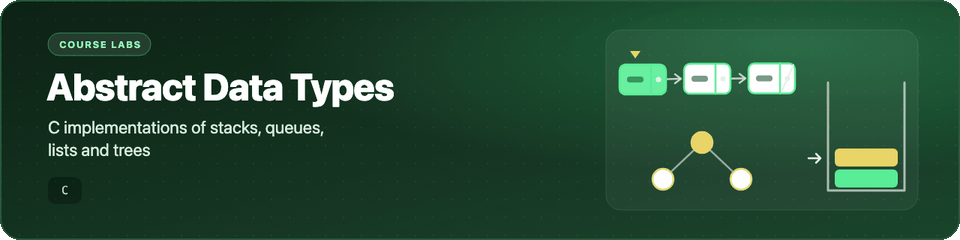

<p align="center">
  <picture>
    <source media="(prefers-reduced-motion: reduce) and (prefers-color-scheme: dark)" srcset="assets/banner-dark.svg">
    <source media="(prefers-reduced-motion: reduce)" srcset="assets/banner-light.svg">
    
  </picture>
</p>

<h1 align="center">Abstract Data Types</h1>

<p align="center">My C lab exercises from 01204212 Abstract Data Types and Problem Solving, a second-year Computer Engineering course at Kasetsart University (2022).</p>

<p align="center">
  
  
  
</p>

## What's inside

- 🔗 Linked lists, stacks and queues built from `struct` nodes and `malloc`.
- 🌳 General trees, binary trees, binary search trees and AVL trees.
- ⛰️ Binary heaps as priority queues, and a Huffman-style tree built from word frequencies.
- #️⃣ Hash tables with separate chaining and with open addressing, plus a small cache simulation.
- 🧪 A short MPI workshop: computing π by Monte Carlo, serially and in parallel.

Each program is a single `.c` file that reads from standard input. Some files are unfinished; they are kept as they were.

| Folder | Topic | What it implements |
|---|---|---|
| [`Lab01`](Lab01) | C basics | Hello world, BMI, a simple calculator, a time converter. |
| [`Lab02`](Lab02) | Control flow and maths | Calendar printing, numerical integration, robot movement, sine/cosine/tangent from series. |
| [`Lab03`](Lab03) | Arrays, strings, recursion | Recursive maze traversal, statistics on an array, substring search, word reversal. |
| [`Lab04`](Lab04) | Recursion | Fast exponentiation by squaring with a call counter, palindrome check, prime check, an "estate planner" tiling problem. |
| [`Lab05`](Lab05) | Structs and linked lists | Singly linked list (append, get, show, reverse, cut), a date/time struct with leap-year checks, a counting game. |
| [`Lab06`](Lab06) | Stack and queue | Linked stack and queue, balanced-parenthesis check, postfix expression evaluation. |
| [`Lab07`](Lab07) | General tree | Attach/detach, search, degree, depth, siblings, ancestors and descendants, path length, BFS and DFS printing. |
| [`Lab08`](Lab08) | Binary tree | Pre-, in- and post-order traversal; checks for full, perfect, complete, degenerate and skewed trees. |
| [`Lab09`](Lab09) | BST and AVL tree | Binary search tree (insert, delete, find, min, max) and AVL tree with single and double rotations. |
| [`Lab10`](Lab10) | Priority queue (heap) | Max-heap with insert, delete-max and update-key; a min-heap that merges word frequencies into a Huffman-style encoding tree. |
| [`Lab11`](Lab11) | Hash table | String hashing with separate chaining (`hashTable1`) and open addressing (`hashTable2`); a direct-mapped cache simulation (`simpleCache`, `check`). |
| [`Lab12`](Lab12) | Sorting | Insertion sort; bubble sort used for an anagram check. |
| [`Midterm`](Midterm) | Midterm practice | Merge sort (2021 midterm). |
| [`hpcnc-workshop`](hpcnc-workshop) | MPI workshop | MPI hello world and Monte Carlo π, serial and parallel. |

## Getting started

You need a C compiler (GCC or Clang).

```bash
git clone https://github.com/Worakornk/Abstract_Data_Types.git
cd Abstract_Data_Types
cc -std=c11 Lab09/bsTree.c -I Lab09 -o bstree
printf '6\n1 5\n1 3\n1 8\n3 3\n4\n5\n' | ./bstree   # insert 5, 3, 8; find 3; min; max
```

Labs 8 and 9 use small helper headers (`week8.h`, `week9.h`); pass the lab folder with `-I` as above. Add `-lm` for programs that use `<math.h>`.

<details>
<summary>Notes on compilers and the MPI workshop</summary>

- The code was written with Visual Studio and MinGW on Windows. Some files rely on things newer compilers reject, such as `void main()`, implicit function declarations or the Windows-only `strrev()`.
- In Lab06, the type name `stack_t` clashes with a system type on macOS, so those files do not build there without renaming it.
- The workshop programs need an MPI implementation such as Open MPI or MPICH:

  ```bash
  mpicc hpcnc-workshop/PiParallel.c -lm -o pi_parallel
  mpirun -np 4 ./pi_parallel
  ```

</details>

## Project structure

```text
Abstract_Data_Types/
├── Lab01/ … Lab12/     # one folder per weekly lab
├── Midterm/
├── hpcnc-workshop/     # MPI examples
└── README.md
```

## Credits

- `Lab08/week8.h` and `Lab09/week9.h` look like helper headers handed out with the course.
- The Monte Carlo π programs in `hpcnc-workshop/` follow a widely shared MPI teaching example (for instance [pimonte_mpi.c](https://www.umsl.edu/~siegelj/cs4790/pimonte_mpi.c.HTML)) and were used as workshop material.

## License

No license is given yet, because some files appear to come from course and workshop material.
